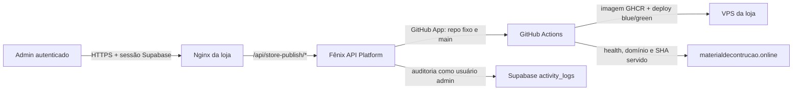

# Arquitetura do fluxo de publicação

## Componentes

A interface nunca recebe token da GitHub App. A requisição à API usa a sessão Supabase atual e a rota relativa `/api/store-publish`; o Nginx termina HTTPS e encaminha somente esse caminho para o serviço existente na porta 3001.

## Contratos HTTP

Todos os endpoints abaixo ficam sob `/admin/store-publish` na Fênix API (prefixo HTTPS público `/api/store-publish`). Todos exigem `Authorization: Bearer <sessão Supabase>` e confirmação server-side do usuário via Auth e RPCs `is_master_admin`/`has_role`. O proxy é restrito ao host materialdecontrucao.online para não expor o endpoint pelo domínio compartilhado do MF Atacadista. O frontend também oculta o controle para contas não administradoras, mas essa checagem visual não é a barreira de segurança.

| Método e rota | Comportamento |
|---|---|
| `GET /status` | Estado de configuração, SHA atual de `main`, última execução bem-sucedida, SHA realmente servido no domínio, arquivos alterados, execução ativa e checagens HTTPS. |
| `GET /history` | Até 20 execuções do workflow fixo, com autor administrativo quando existe registro em `activity_logs`. |
| `POST /runs` | Aceita somente `requestId` UUID v4 e `expectedSha` de 40 hexadecimais; fixa `ref=main`, bloqueia duplicatas e retorna o run real criado. |
| `GET /runs/:runId` | Consulta estado, jobs e etapas reais do GitHub Actions. A interface atualiza a cada 4 segundos, sem porcentagem estimada. |
| `GET /runs/:runId/logs` | Faz streaming do arquivo ZIP de logs após a execução terminar. |

O servidor valida que o SHA confirmado ainda é o SHA de `main`, que não há outra execução ativa e que o domínio serve homepage, `/healthz` e um SHA de deploy. A prontidão do proxy é uma checagem separada: a Fênix API precisa receber 401/403 na chamada sem token. Uma reserva no Redis e a chave idempotente impedem cliques repetidos; o GitHub também serializa os deploys em `production-deploy`, sem cancelar uma execução ativa.

## Workflow e prova de publicação

O workflow executa pré-verificação da VPS, testes de catálogo, lint bloqueante, TypeScript, build, imagem Docker e deploy blue/green. A imagem contém `deploy-version.json` com o SHA do commit. O script da VPS verifica `/healthz`, a página HTTPS e esse SHA após a troca; se qualquer verificação falhar, restaura o slot anterior. A Action também confirma externamente que o domínio serve o mesmo SHA. Apenas uma execução concluída com sucesso nessas etapas aparece como publicada.

Pushes existentes para `main` continuam acionando deploy automático. Um clique no painel só pode selecionar o `main` já enviado ao GitHub. Alterações de conteúdo do admin continuam no banco e não acionam deploy.

## Segredos e permissões

Configurar somente no ambiente privado da Fênix API Platform, nunca no frontend nem no Git:

- `STORE_SUPABASE_URL` e `STORE_SUPABASE_PUBLISHABLE_KEY`: validar sessão e papel administrativo da loja.
- `STORE_SUPABASE_SERVICE_ROLE_KEY`: acesso restrito server-side ao `activity_logs`, necessário porque a tabela aplica RLS. Nunca enviar ao navegador.
- `GITHUB_APP_ID`, `GITHUB_APP_INSTALLATION_ID` e `GITHUB_APP_PRIVATE_KEY`: emitir token temporário da GitHub App.
- Instalar a App somente no repositório `Biel0071/fortlev-quote-master`, com Actions `Read and write`, Contents `Read` e Metadata (obrigatório) `Read`.

A chave privada aceita PEM com `\n` literal; o serviço converte para quebras reais. O workflow existente mantém seus secrets de build e SSH. Nenhum valor secreto foi configurado durante esta implementação.

## Estado de infraestrutura observado

A API Platform está ativa na VPS, mas a loja ainda não está provisionada nela: `/opt/app`, `app_blue`/`app_green`, `edge.conf` e o certificado do domínio não existem. O DNS atual aponta para `185.158.133.1`. Por isso, o status exige que `/api/store-publish/status` retorne 401/403 (rota protegida real) e que `/deploy-version.json` contenha um SHA antes de habilitar o botão. Hoje o caminho retorna HTML 200 e o marcador 404, então a publicação permanece bloqueada.
